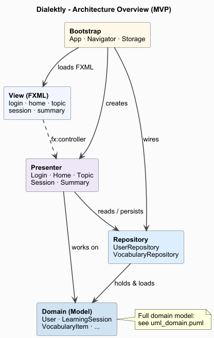
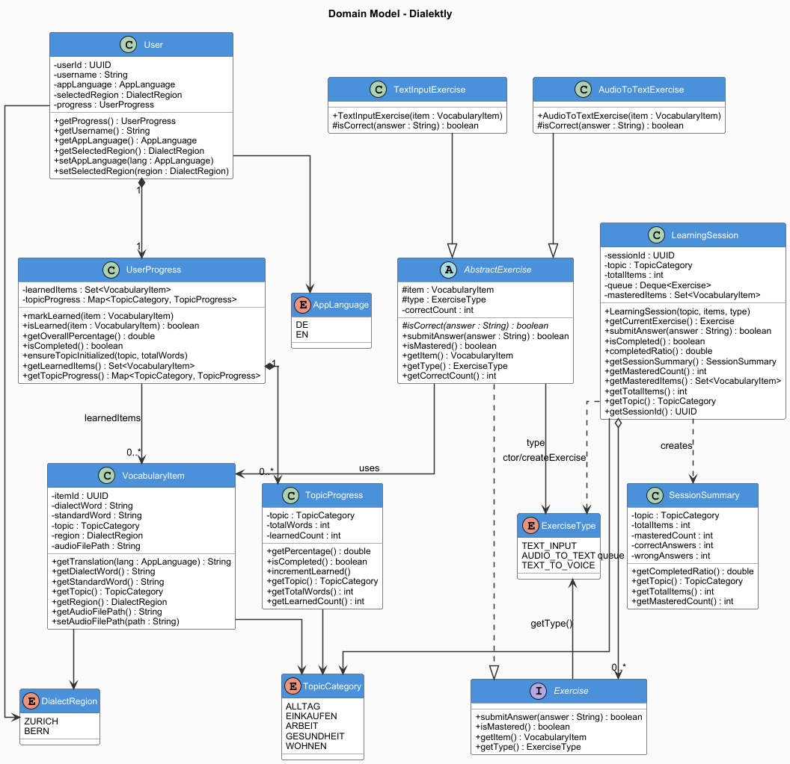

# Video
https://github.com/user-attachments/assets/2be190b4-9327-4adc-9ed3-aadca7687b87


# team03-nullpointerninjas-projekt2-dialektly
PM2 Team03 NullPointerNinjas 2026 Projekt2 Dialektly

## Table of Contents
- [Workflow](#workflow)
- [Class overview](#class-overview)
- [Installation](#installation)
- [Tests](#tests)
- [MVP](#mvp)
- [Contact](#contact)

## Workflow

This project follows a structured branching strategy to keep development organized and the main codebase stable.

### Branch Structure
- `main`: Production-ready code only. Never commit directly to this branch.
- `dev`: The integration branch where all completed features are merged into.
- `<issue-number>-*`: Short-lived branches for developing new features or fixes.

### Workflow Steps
1. **Create an Issue**: Start by creating an issue in the repository to track the feature or bug you intend to work on.
2. **Branch Creation**: Create a new branch out of the issue with a descriptive name (e.g., `<issue-number>-add-new-strategy`).
3. **Development**: Develop and test your changes on the feature branch.
4. **Pull Request**: Once the feature is fully implemented and tested, open a Pull Request from your feature branch into `dev`
5. **Code Review**: Team members will review the code, suggest changes if necessary, and approve the PR.
6. **Merge**: Once approved, the **creator of the Pull Request** merges the branch into `dev`.
7. **Cleaning up**: After a successful merge, the feature branch is deleted and the corresponding issue is closed.

### Naming Convention
Feature branches should follow this pattern:

`<issue-number>-<short-description>`

### Key Rules
- Every branch must originate from a GitHub Issue — no issue, no branch.
- Never commit directly to dev or main.
- Only the Pull Request creator may merge, but only after receiving at least one approval.
- When dev is stable and ready for release, it is merged into main.

## Class overview

### UML



### Reasoning

The application follows **Model-View-Presenter (MVP)**, organised into four packages: `Bootstrap`, `View`, `Presenter`, `Model`.

Within MVP we use an **observer-based** approach. The Models — `LearningSession`, `UserProgress`, and `Exercise` — act as observables that carry state for the active screen. Each Presenter is the registration point: it receives the relevant Model, hooks up the View as an observer, and lets the View react to Model state changes directly. When `Exercise.submit()` increments `correctCount` and flips `isMastered`, the change in `LearningSession.masteredItems` propagates to the progress bar and next-word display without the Presenter pushing each field manually.

**Bootstrap layer.** `App` (extends `Application`) is the entry point and instantiates `Storage`, `AppState` and `Navigator` once. `AppState` is the single in-memory container which holds all users, the selected user, the active session, and the loaded vocabulary. `Navigator` owns all scene-switching (FXML loading, Presenter wiring) and hosts the two cross-screen operations: `handleLogin()` finds or creates a user, and `finalizeAndShowSummary()` merges round results into `UserProgress` and calls `Storage.saveUsers()`.

**View layer.** Five FXML files (`login.fxml`, `home.fxml`, `topic.fxml`, `session.fxml`, `summary.fxml`) with one Java FXML-controller each. Controllers hold `@FXML`-wired widgets and delegate user events to their Presenter.

**Presenter layer.** One Presenter per View, each receiving only what it needs. `LoginPresenter` gets a `List<String>` of usernames; `HomePresenter` gets the `User`; `TopicPresenter` gets the `User` plus the vocabulary; `SessionPresenter` gets its `LearningSession` via `setSession()` after construction; `SummaryPresenter` gets the completed session. All Presenters hold a `Navigator` reference for transitions.

**Model layer.** Plain Java classes: `User`, `UserProgress`, `TopicProgress`, `LearningSession`, `Exercise`, `VocabularyItem`, plus four enumerations (`AppLanguage`, `DialectRegion`, `TopicCategory`, `ExerciseType`). `User` contains its `UserProgress` as a direct attribute, so a user with their full progress serialises as one JSON document. The core game rule lives in `Exercise.submit()` and `LearningSession.submitAnswer()`: every item must be answered correctly twice to be mastered; wrong answers push the exercise to the back of the queue; mastered items leave the queue and join `masteredItems`. `UserProgress.learnedItems` holds `VocabularyItem` references, not UUIDs.

**Persistence.** One class, `Storage`, with three methods: `loadUsers()`, `saveUsers(users)`, `loadVocabulary()`. `App.start()` loads users and vocabulary once; `Navigator.finalizeAndShowSummary()` saves the user list once per completed round.

**Out of scope for v1.** XP, levels, streak counts and badges.

## Test concept
See [test_concept.pdf](test_concept.pdf)

## Installation
1. Clone the repository:
   ```bash
   git clone https://github.zhaw.ch/PM2-IT25taWIN-muon-welj-bira/team03-nullpointerninjas-projekt2-dialektly.git
   ```
2. Start the application with gradle:
   ```bash
   gradlew run
   ```

## Tests
To run the tests, use the following command:
```bash
gradlew test
```

## MVP

Below you find a quick summary of the project sketch.
See full project-sketch here:
[ProjectSketch.pdf](ProjectSketch.pdf)

### 1. Onboarding Flow
*First-time setup of the app by the user.*

1. **Selection of already registered users**
2. **In case of registering a new user**
   1. **Selection of dialect region** — Zurich or Bern
   2. **Selection of user language** — German (DE) or English (EN)
      > The architecture is designed to be multilingual from the start, so additional languages can be added later without structural changes.
3. **Selection of a topic area** — Everyday Life, Shopping, Work, Health, Housing *(10 vocabulary items each)*

### 2. Vocabulary Trainer Exercise Session
*Flow of a learning round. One round covers 10 vocabulary items.*

1. **Load vocabulary item** — Swiss German word with an audio recording of the correct pronunciation
2. **Play audio** — User listens to the correct pronunciation
3. **Input via text entry** — User types the translation in their chosen language (DE or EN)
4. **Automatic evaluation**
   - ✅ Correct → `correctCount++`; item leaves the queue once it has been answered correctly twice
   - ❌ Incorrect → the exercise is pushed to the back of the queue and will be asked again
   > The prototype currently supports only text-input exercises, but the system is designed to scale with additional types like multiple-choice and pronunciation. Images were removed from the exercise design to avoid distracting from the core learning objectives. The application is intended to function as a vocabulary trainer, not an image-recognition tool.
5. **Round completion** — The round ends when every exercise has been answered correctly twice

### 3. Learning Progress & Session Summary
*Persistent storage of the learning status and display of progress.*

1. **Save user data in JSON files** — Learning status and progress per topic area are stored in structured JSON files.
   > The backend can later be replaced by a database (e.g. Supabase/PostgreSQL) by swapping the implementation of `Storage`. Multiple users are distinguishable via the file schema.
2. **Display learning progress**
   - Overall progress across all topics
   - Progress bar per topic area (e.g. *"Shopping: 7/10 vocabulary items"*)
3. **After session: display summary**
   - Number of vocabulary items practiced
   - Accuracy
   - Newly mastered items
4. **On next launch: seamlessly continue** — User list is loaded from JSON on startup and shown on the login screen

### 4. Content Management & Backend
*Data storage and infrastructure for the prototype.*

#### Vocabulary Data

1. **Structure vocabulary data in JSON files** — Per entry: word, image reference, audio clip, dialect region, topic area
2. **Provide 50 vocabulary items** — 5 topic areas × 10 words, per dialect region

#### Multilingual User Interface

1. **Store UI texts for DE and EN**
2. **Runtime language switching** — Language can be changed at any time within the app

### 5. AI Speech Recognition *(Optional)*
*Optional feature: pronunciation training with AI feedback. Findings are to be documented in writing.*

1. **Integrate Whisper model** — OpenAI Whisper (fine-tuned on Swiss German) as the speech recognition engine
2. **Record and send user audio** — User speaks the Swiss German vocabulary item aloud; recording is sent to Whisper
3. **Evaluate recognition result** — Whisper transcribes the recording; text is compared with the target vocabulary item; a similarity score is calculated (e.g. Levenshtein distance)
4. **Display feedback** — Accuracy score is shown to the user
5. **"Incorrectly recognized" button** — User can dispute the recognition result
   > In the prototype: repetition without negative scoring


## Contact

- Sven Scheuss (schsve01@students.zhaw.ch)
- Joris Neber (demo@example.com)
- Lena Wöhrle (woehrlen@students.zhaw.ch)
- Raphael Stricker (stricrap@students.zhaw.ch)
